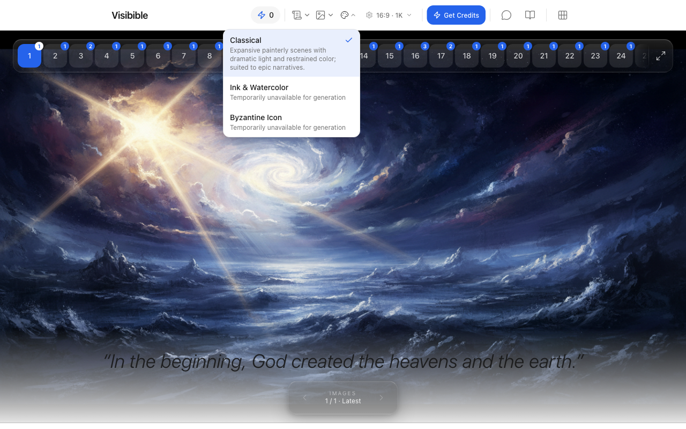
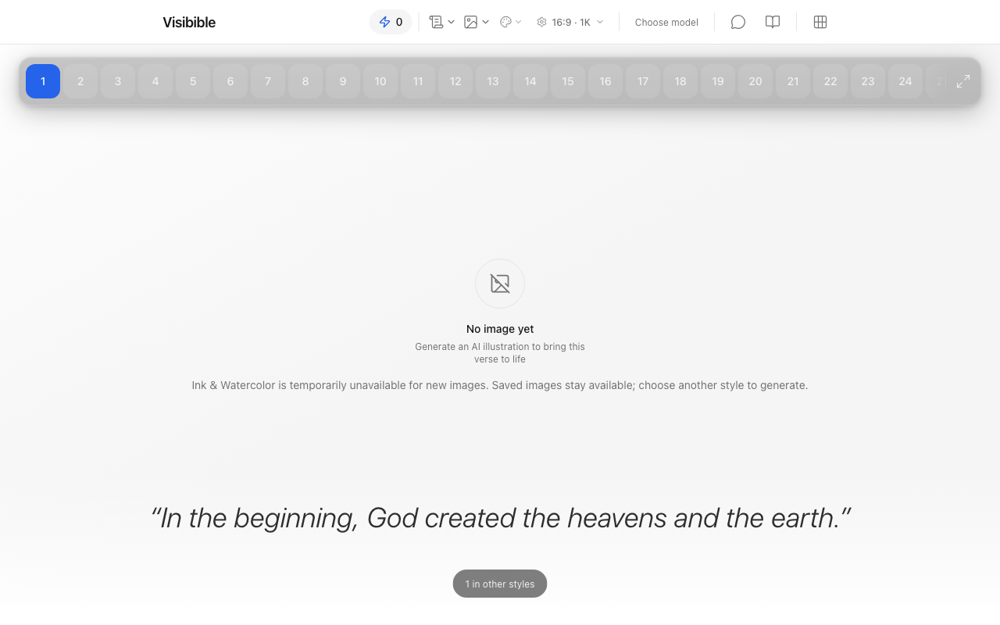
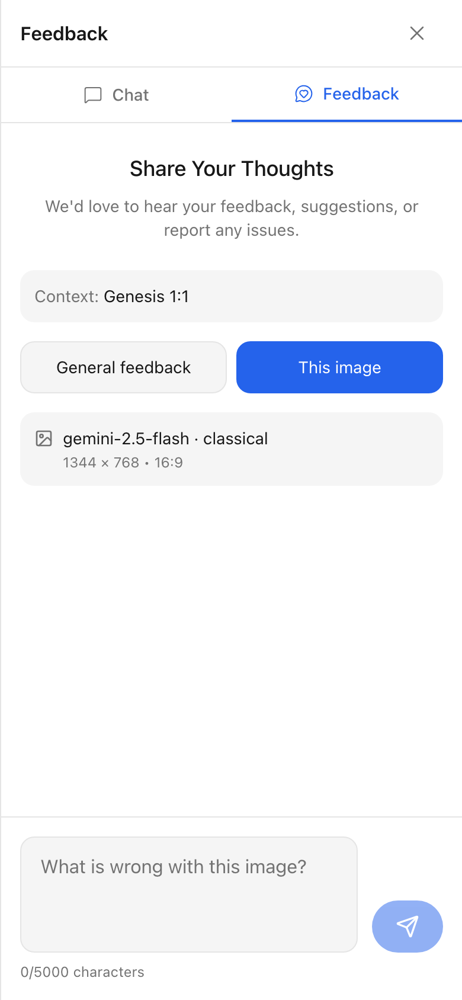

# Disabled generic-engine deployment — 20 October 2026

This records the compatibility deployment for [#183](https://github.com/AustinKelsay/visibible/issues/183). It is not the public activation decision. Preparation, paid candidate evaluation, production accounting/latency evidence and human visual acceptance remain outstanding. [#184](https://github.com/AustinKelsay/visibible/issues/184) remains blocked; no legacy execution or historical records were retired.

## Deployed configuration

| Field | Observed value |
| --- | --- |
| Release | [PR #203](https://github.com/AustinKelsay/visibible/pull/203), including [repair PR #204](https://github.com/AustinKelsay/visibible/pull/204) |
| Production commit | `505ae51a6350dfc8270b0f4175247e4688079644` |
| Reviewed dev head | `8b875e990fab4ca25689f2f8e6b937884ca0c10e` |
| Vercel team / project | `austin-kelsays-projects` / `visibible` |
| Deployment | `dpl_96YW2JaiDTLwXJZHkRPU24bzrQpc`, READY; build duration 30 seconds |
| Frontend | [visibible.com](https://visibible.com), deployment `visibible-8a1950s15-austin-kelsays-projects.vercel.app` |
| Backend | Production Convex `unique-impala-244`, exposed through `api.visibible.com` |
| Admission | `GENERIC_ENGINE_MODE` unset, which resolves to `disabled` |
| New generation | Legacy engine, Classical only |

The Vercel Git build deployed compatible Convex functions before building the frontend. No admission environment variable was changed. The production work status at `2026-10-20T20:05:38.457Z` was not ready (`work is not registered`), as expected before production preparation.

## Checks

- The [integrated CI run](https://github.com/AustinKelsay/visibible/actions/runs/39488476057) passed lint, typecheck, coverage thresholds, the production dependency audit and the production build. Local verification passed 86 test files and 790 tests. A separate fresh-checkout build traced both generated work JSON files and all three style files into the image route.
- The implementation PRs were reviewed individually. CodeRabbit skipped the combined release diff because its 152 files exceeded the 150-file limit. The repair received a CLI review with zero issues and an unverified-findings warning; its typed-reference follow-up received a second CLI review with zero issues and no warning.
- The protected dev deployment's `/api/image-models` returned Classical available and Watercolor/Icon unavailable. The production API returned the same state after deployment.
- `/genesis/1/1` still displays historical image `kh7bt229kf6zp3jdmy8b3r976d838qdd`. The latest-image and history endpoints returned 200 before and after the deployment, preserving its ID, image URL, model, translation ID, creation time and dimensions. It is exposed as `artStyle: "classical"`. This public API check does not expose or compare the stored verse text.
- The Genesis 1:1 history endpoint returned one image with `?style=classical`, zero with `?style=watercolor`, and 400 for an unknown style. The request without a filter retained the historical image.
- Production `bindLegacyJobs` completed idempotently: zero jobs existed, zero were changed. The inventory found zero queued/in-flight/uncertain requests, zero unbound bulk items and zero accepted obligations. It preserved 166 succeeded and 16 failed historical legacy requests. An empty inventory is not the later retirement decision.
- The release deployment's runtime error scan from `19:56:29Z` through `20:06:29Z` returned zero records. This is a short smoke-check window, not the required post-activation 24-hour observation.

The browser checks below ran on production without making an image request or submitting feedback. Selecting an unavailable style retains the preference; viewing the historical Classical image then opening **This image** reports Classical and the exact image dimensions despite Watercolor remaining selected.

## Budget and remaining release evidence

Austin Kelsay is the human release owner. The authorized release cap is **$60**, separate from the earlier prototype allowance: **$43 preparation, $16 evaluation, $1 production smoke**. Each paid command also has its own smaller stop limit. Optional reference images may finish afterward and must not consume the evaluation or smoke allowance.

The fixed evaluation plan retains all 33 Bible cases and three Holmes cases, all three generic styles and three repeats (324 candidate samples). Its dry run estimated $11.66 under a $12 cap. The Bible baseline retains the same 33 Bible cases and settings, three repeats and the production planner configuration (99 samples, estimated $3.47 under a $4 cap). Actual spend and scored output belong in the later evaluation record; these estimates are not completed evidence.

Before public admission, finish complete production Bible analysis and canon, merge the separate one-file approved brief PR, verify readiness/source credits, review the baseline/candidate images, measure full-request prepared/cold p90 and real reservation/settlement, and record the release acceptance. No test fixture or partial reading is an approved production brief.

## Rollback and follow-up

The current configuration already uses the disabled rollback setting. For a later owner/public rollout, set production `GENERIC_ENGINE_MODE=disabled` and redeploy to stop new generic admissions. Accepted work retains its recorded engine, billing and replay. Keep both execution paths and all saved images; do not cancel uncertain attempts or reinterpret accepted jobs.

Use the [release runbook](../../workflow/ENGINE_RELEASE.md) for owner-only checks and the later public transition. Name and record the first-24-hour observation window when public activation actually occurs. This deployment does not start that window.
