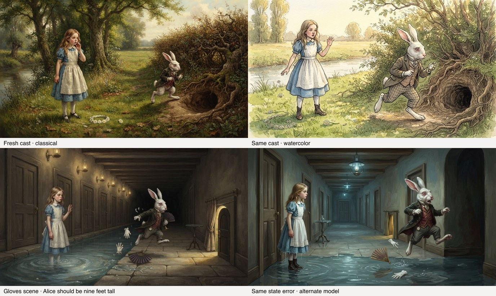

# Identity visual diagnostic — do not activate

The corrected Alice identity merge now has an end-to-end local diagnostic through fresh canon, reference sheets, scene plans and rendered images. It did not demonstrate a visual continuity improvement over the existing fixture. It does **not** establish readiness to activate: the gloves scene loses Alice's source-required giant size across image models. Stable appearance and correct temporary state need separate evidence.

The examples use the first scheduled repeat and the pipeline's chosen attempt, not selected favorable repeats; source hashes are in `examples.json`.

## What ran

- 69 Alice canon entries drafted from the accepted identity merge; 12 retain validator problems, including dropped unsupported quotations. No manual cleanup before comparison.
- Classical style reference and Alice/Rabbit sheets created locally. Watercolor style-reference preparation failed all three ordinary attempts; its scene arm used the normal no-style-reference fallback. The Rabbit sheet needed two attempts. Advisory canon/sheet differences remain recorded.
- Nine scene plans frozen once. Five conditions each scheduled nine outputs: prior Alice fixture, fresh Alice candidate, same candidate in watercolor, same candidate on the alternate image model, and a retained Bible control. Three repeats per scene. Candidate plans and cast references were reused across theme/model variations.
- All 45 scheduled cases accounted for: 44 returned images, one provider refusal. Ten ordinary retries produce 54 saved scene attempts. The refused scene was never rerolled. Two independent model-scoring passes cover every saved attempt and all 108 scheduled identity pairs, including five pairs made unclear by the missing image.

`plan.json` is the original frozen contract; `inputs.json` and phase-started records preserve source hashes. The original image phase stopped on missing provider usage. `CONTINUATION.md` explains the bounded continuation and subsequent scoring MIME-type failure, with all previous costs and answers retained. Neither incident changes quality criteria or regenerates failed scene samples.

## Recorded results

Both independent model passes completed 162 judgments: 54 saved scene attempts and 108 scheduled pairs. Five missing-image pairs per pass are automatically unclear; 157 visual judgments per pass were made by the model. Fifteen field disagreements across the full image/pair set are retained and unadjudicated. These are model judgments, not a release gate.

| Within-condition identity pairs (18 each) | Both same | Both different | Both unclear | Disputed |
| --- | ---: | ---: | ---: | ---: |
| alice-baseline | 17 | 0 | 0 | 1 |
| alice-candidate | 6 | 1 | 10 | 1 |
| alice-theme | 9 | 0 | 9 | 0 |
| alice-model | 8 | 1 | 9 | 0 |
| bible-control | 6 | 3 | 8 | 1 |

Nine of the fresh candidate's 18 Rabbit comparisons involve valid Rabbit absence in the house scene; an additional pair is unclear. The differing scene coverage prevents a clean superiority claim. The same-case theme comparison has 4 same / 1 different / 3 unclear / 1 disputed pair; the alternate-model comparison has 3 same / 3 different / 3 unclear. The fresh candidate therefore does not demonstrate an identity improvement, and cross-theme/model identity is not established.

All 44 returned chosen images received agreeing style-adherence judgments, while the watercolor arm had four agreeing artifact failures. State-correctness failures and judge inconsistencies remain separately visible in `report.json`. High focal-action scores do not negate a source-state failure.

**Funding closed:** $2.74664180 measured plus $0.13362535 conservatively reserved = **$2.88026715 maximum**. Unused allowance: $3.11973285. This includes both interrupted runs and both scoring passes. The live closing check confirms the $5 reader reserve remains protected; no additional funding is requested. See `funding-close.json` and the per-phase ledgers.

## Findings and limits

1. **Temporary source state is lost.** The gloves scene's chapter establishes Alice at nine feet tall. The frozen planner receives the focal paragraph and adjacent tears paragraph, not the earlier height statement; the candidate plan explicitly calls her small. Images reproduce this error in both image models. A richer actual source-context input is the smallest next experiment; no new fact database or extra model stage is justified by this result.
2. **Appearance memory includes episode props.** Rabbit canon includes gloves/fan and herald trumpet/scroll, and its sheet shows them together. Candidate gloves sample 1 includes a second fan and a small brass horn-like object. This supports testing a cleaner distinction between stable appearance and current scene props, not adding an entity ontology.
3. **Valid staging affects the identity denominator.** The candidate Mary Ann plan selects Alice inside the house, within the focal text. The Rabbit is absent, so those Rabbit comparisons are unclear. Absence is neither continuity success nor an automatic source-fidelity failure.
4. **Judges are imperfect.** Both passes use independent requests to the same Haiku model, with condition labels and other answers withheld. Correlated mistakes remain possible. Operator inspection is unblinded model review, not human acceptance. Some notes misorder Alice's later shrinking or accept a daisy chain that the text only considers making. `report.json` preserves all disagreements rather than laundering them into consensus.

The Bible control reuses the earlier retained snapshot and matching reference blobs; it is not a fresh Bible reading or current production snapshot. Baseline/candidate Alice differ in canon and sheet coverage, with their own frozen plans; any visual difference cannot be attributed solely to higher reasoning. The style-reference fallback limits the watercolor comparison. Failed reference pixels were not saved by the existing module; provider content lookup returned 404. Only their check notes, response hashes and costs remain. All saved scene attempts remain locally available under `evals/images/runs/2026-10-30-identity-visuals/`.

No production data, reference sheets, active analyses, runtime code, model defaults or reader images changed. This diagnostic is not the existing release gate and cannot authorize a public rollout.

## Reproduction and verification

- `scripts/evals/identity-visuals.mts --offline`: full synthetic rehearsal in a temporary directory; 45/45 outputs. This validates mechanics only.
- Paid phases are deliberately one-shot, with frozen inputs, durable ceilings and explicit continuations for the recorded interruptions. They refuse completed runs.
- `scripts/evals/identity-report.mts`: recompute aggregates from the recorded answers, preserving every disputed field and unclear pair.
- Application verification: 1,051 tests passed, one skipped; typecheck, lint (three existing warnings), production build and dependency audit passed. Runtime sources and input hashes match each paid phase. See `verification.json` and `REVIEW.md`.
