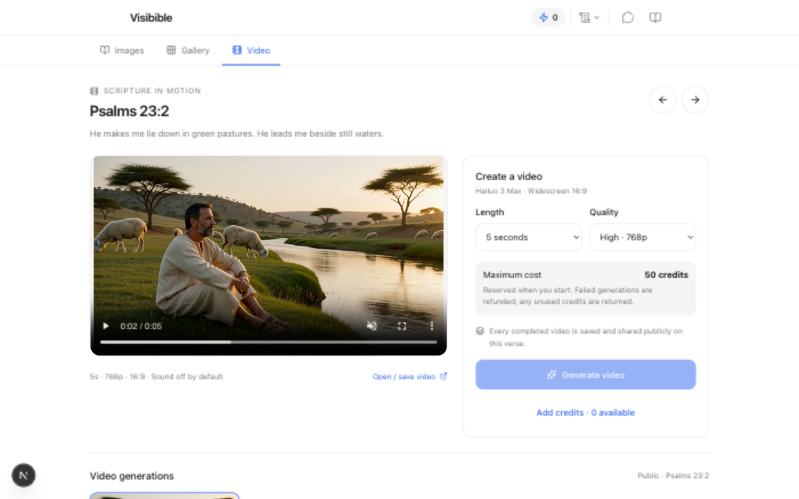
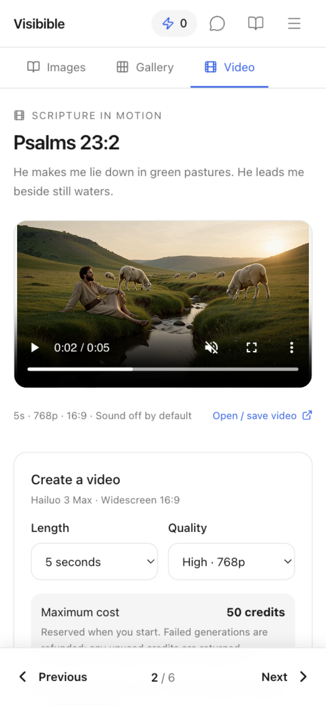

# Video mode integration evidence

The hosted preview at code commit `96d2cfa9224f909d92e959f8fdb71a779844f0ef` completed one Psalms 23:2 video using Hailuo 3 Max: 5 seconds, 768p, $0.40 provider cost, 50 credits, 15.616 seconds. [Machine-readable report](hosted-report.json).

- Frontend: `https://visibible-paml4gzx8-austin-kelsays-projects.vercel.app`
- Backend: `https://coordinated-shepherd-515.convex.cloud`
- Normal credited guest; initial 100 credits, final 50. Exactly one job and one generation charge, with the reservation released and zero absorbed cost.
- An identical admission replay returned the same job. Navigation away occurred during processing. The job completed before the later close/reopen check, so this live run does not establish closure mid-job.
- Permanent storage and public history verified; desktop playback, sound, seeking, and HTTP 206 passed. A different zero-credit guest played the same clip in an incognito mobile viewport. The report distinguishes the browser-visible header (not exposed by CORS) from an unauthenticated transport check returning `Content-Range: bytes 0-31/7142553`. The local-only paid smoke script was not used on this hosted deployment.

These are hosted screenshots: desktop 1280×800 and mobile viewport 390×844.

Local verification passed: 1,150 tests (one skipped), typecheck, lint (three pre-existing release-script warnings), and 82.22% statement coverage. Works validation passed. Final-code CI passed its production build and dependency audit. Local browser checks also covered refresh, mode switching, mobile verse navigation, and the credit-purchase entry flow without making a purchase.

A controlled local job exercised actual reservation/refund mutations, refresh, and cross-verse active state without a provider call. Accepted-job completion with admission disabled is covered by the worker test; the disabled UI retains public history. Only the 5s/768p SKU was exercised live. A mobile viewport is not physical-device testing.

Sol approved the behavior in two review rounds. Fixes preserve the exact displayed settings and maximum charge during interrupted-request recovery, expose pricing retries after catalog outages, and avoid browser-only AbortSignal static helpers. The first two regression tests failed before the fixes and passed afterward.

Before the first push, a guarded shared-development Convex dry run reported seven additive video indexes and no deletions. Both preview build logs confirmed no index deletion. The PR records final checks and review status. Production rollout remains a separate release decision.

After the live smoke, a one-line client error fallback was added for non-JSON platform errors. HTTP 400 clears a definite rejected intent; HTTP 503 retains the same intent for safe retry. Both tests failed before the fix; all 15 focused client/UI tests pass afterward. This does not change the worker or the successful hosted path.
