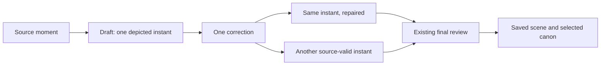

# Correct the scene without freezing the draft

**Recommendation:** retain the existing single correction and final review. Treat preservation of the draft's depicted instant as a preference subordinate to source fidelity and binding constraints. This is a proposed evaluation contract, not a new runtime rule or a claim that the unapplied draft-aware candidate works.

The [previous comparison](../2026-11-01-replan-draft-text/REVIEW.md) exposed two different questions: did a correction repair the scene, and did it preserve the chosen instant? It also stopped before the existing final review. This free pass separates those questions and traces that missing stage mechanically. No providers, accounts or production data were contacted; no budget was spent.

## Source span and depicted instant

A **moment** is the span of source text assigned an illustration. A **depicted instant** is one coherent visual state chosen from its content. A verse can describe both a camp remaining in place and its later departure. Either may illustrate that verse, while a single image combining incompatible stages can still be wrong.

For a future comparison, assess three separate questions:

| Question | What establishes it |
| --- | --- |
| Repair | The reported defect is gone; a change of wording alone is insufficient. |
| Validity | The resulting scene fits the focal content, relevant context, work brief, depiction rules and binding owner constraints. Target repair alone is insufficient. |
| Preservation | The compatible chosen instant and unaffected details remain, or the correction changes them. A source-valid change is recorded separately from an invalid scene. |

Prefer retaining compatible details. Allow another representative instant when the draft cannot be repaired coherently within the governing inputs. An unnecessary but source-valid change loses preservation credit; it is not automatically a source error. An apparent conflict with binding owner constraints remains visible under the existing owner-correction policy. This proposal grants no permission to silently override them.

The Queen's earlier listening instant and the camp's departure are examples of possible valid alternatives, not proof of the original preservation targets. The previous smile/camp criteria and all recorded judgments remain unchanged. The [existing release gates](../../../docs/adr/0011-frozen-multi-work-regression-suite.md) still apply; this distinction neither passes them nor creates an activation exception.

These are assessment questions, not new model fields, a classifier or another review call. Source and work data govern events and depiction; recurring designs stay in canon; art style stays rendering treatment. A draft does not make a smile, pose or former cast selection permanent.

## What the final review already does

At base `93c30fc7deac127d61b12a2cbbedd097d4a93a52`, each planner reply begins with its own selected IDs. The [same review path runs in both rounds](https://github.com/AustinKelsay/visibible/blob/93c30fc7deac127d61b12a2cbbedd097d4a93a52/src/lib/engine/preparation.ts#L314). A reported `unselected_figure` is added before storage. A first-round addition is not automatically carried into a later correction that drops it.

The final review gets the current scene, all section-cast names and IDs, and canon for the currently selected entries. It does not get the earlier draft or a preservation comparison. Its [validation](https://github.com/AustinKelsay/visibible/blob/93c30fc7deac127d61b12a2cbbedd097d4a93a52/src/lib/engine/plan-review.ts#L94) checks quotations and IDs, not whether a quoted cottage really is the named house.

[trace.json](trace.json) records four conditional executions through unchanged preparation and assembly, using the two retained branch corrections:

| Retained correction | Scripted final review | Observed rendering input |
| --- | --- | --- |
| Cottage described, house ID omitted | Reports the house as depicted | House selected, canon included, sheet lookup attempted |
| Same correction | Empty problem list | House remains unselected |
| Same correction | Unreadable twice | House remains unselected; unavailability noted |
| Cottage removed, house ID omitted | Empty problem list | House remains unselected |

The reports in this table are **scripted premises, not model judgments**. In particular, the local dialogue does not independently establish the cottage as the March Hare's house. The positive branch proves dispatch if that attribution is reported; it does not validate the attribution or demonstrate the review's reliability. The removed-cottage branch shows why automatically retaining every former cast ID would be wrong.

The added ID reaches the saved `entries`, returned `present`, and [rendering canon](https://github.com/AustinKelsay/visibible/blob/93c30fc7deac127d61b12a2cbbedd097d4a93a52/src/lib/engine/assemble.ts#L117). `grounding.cast` remains the planner's selection evidence and omits the reviewer-added ID; assembly does not use it to select canon. Thus its absence there is not a lost rendering selection.

Two limits matter. The newly added house canon was absent from the review request and is not reviewed again after the addition. Also, inclusion makes its sheet a candidate, not a guaranteed attachment: reference availability, currency and slots still apply. All four traces deliberately return no references, matching the retained branch's lack of attachments. They produce prompts, not images. These are existing [forgiving-review tradeoffs](../../../docs/adr/0004-forgiving-scene-preparation.md), not grounds here for another loop or a mandatory cast union.

## Reproduction and scope

The session replay used Node 26.12.1 and the existing `createMemoryPreparationStore`, `createOpenRouterTextModel` with a fake fetch, and `assembleRendering`. Global fetch was blocked. No candidate patch was applied. To reconstruct it from the retained inputs:

1. Load the [v2 snapshot](../2026-10-31-suite-v2-baseline-text/snapshot.json) and `alice-cheshire-cat-bough` result. Seed its section, cast entries, moments and saved look; leave its plan absent. Read the unchanged work inputs.
2. Take provider lines 395/396 from the [v2 exchanges](../2026-10-31-suite-v2-baseline-text/provider.ndjson). Apply exactly the branch-control edit and added problem in [cases.json](../2026-11-01-replan-draft-text/cases.json). These are the first two fake responses.
3. Inject the full captured `content` of `branch-control/with-draft/2` from [answers.ndjson](../2026-11-01-replan-draft-text/answers.ndjson) as the correction. Use repeat 1 for the removed-cottage branch. The unchanged engine's correction request matches the retained baseline packet: these captured candidate answers are deliberately injected, not claimed to have been generated by that request.
4. Return the exact final-review premises in `trace.json`; for unavailability return its malformed string twice. Assemble `pig-and-pepper-50` in Watercolor, 16:9, with no variation and every reference lookup returning null.
5. Compare request hashes, stored entries/audit/notes, rendering canon, reference lookups and prompt hashes with the trace. All seven rendered scene fields equal the captured normalized correction. The paths use 4/4/5/4 fake calls respectively and zero provider calls.

The trace pins source/code hashes and input versions. It establishes conditional mechanics, not source correctness or model efficacy. The existing plan-review, engine-presence and cast-policy suites passed **44 tests**. No application code, prompts, work data, historical evidence or release gate changed; the two glossary edits clarify terminology only.

## Next decision

Keep the draft-aware candidate unapplied. If further measurement is commissioned, finish the missing stage first: submit the retained corrections to the **existing final review**, using each correction's selected canon, then inspect the actual saved scene and canon after its normal handling. Freeze the questions above before execution, preserve all failed/ambiguous outcomes and review cast attribution independently; an empty report is not a quality verdict. That would isolate the unanswered model behavior without generating another set of plans or images. Price and cap that operation before any spend.

There is no demonstrated dispatch bug to fix here and no evidence supporting an additional repair layer. Activation still requires quality evidence for the complete candidate path. This design pass neither changes that bar nor authorizes another run.
