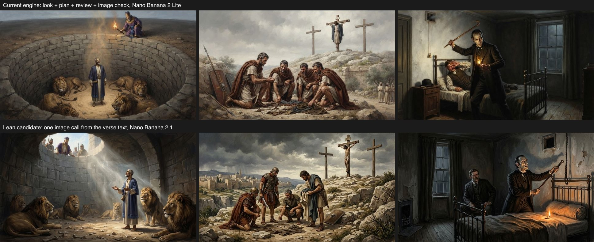

# Lean engine: one image call from the text, against the full engine

**A plan-free pipeline on Nano Banana 2.1 matches the full engine on image quality and passes the suite gate against it.** It keeps people more consistent and places less consistent. It is an evaluation candidate: production is unchanged, and switching needs the owner's decision.

The owner asked on 9 November 2026 whether the consistency pipeline had grown too bloated and whether a simpler approach could replace most of it ("let's see if that allows us to clean down 90% of this bloat ... prototype it and get as far as you can systematically end-to-end full send").

## What was compared

| | Full engine (production) | Lean candidate |
| --- | --- | --- |
| Model calls per new image | section look, scene plan, plan review, image, image check; sometimes a re-plan and a second image | one image call |
| Image model | Nano Banana 2 Lite | Nano Banana 2.1 |
| What the image model reads | a seven-field scene plan, canon of the planned cast, up to 3 references | the moment's own text and its neighbours, canon of the whole section cast, up to 5 references |
| Code | `preparation.ts`, `plan-review.ts`, `scene-grounding.ts`, `scene-check.ts`, `assemble.ts`, `prompt.ts` | [`lean.ts`](../../../src/lib/engine/lean.ts), 180 lines |

Both arms drew the same 79 cases of suite `2026-11-01-suite-v3` in each work's image styles, from the same canon and reference sheets. The lean arm read the [7 November snapshot](../2026-11-07-suite-v3-text/snapshot.json) and the full arm its own 2 November one; the two are [identical](full-arm/snapshot-comparison.json) in every record, reference sheet and case. The lean arm keeps the reading pass, canon, sheets, briefs, styles and depiction profiles. It drops looks, plans, the plan review and the finished-image check.

## Image quality

410 images (206 lean, 204 full) were shuffled into one blind pack and judged against the moment's text by two scorers, with disputes adjudicated blind.

| Work | Full engine | Lean | Full, small marks accepted | Lean, small marks accepted |
| --- | --- | --- | --- | --- |
| Bible (3 styles) | 107 of 144 (74%) | **113 of 144 (78%)** | 111 (77%) | **119 (83%)** |
| Holmes (2 styles) | 4 of 30 | 10 of 30 | 18 of 30 | 21 of 30 |
| Alice (2 styles) | **12 of 30** | 7 of 32 | **20 of 30** | 15 of 32 |
| All | 123 of 204 (60%) | 130 of 206 (63%) | 149 (73%) | 155 (75%) |
| Holdout | 26 of 49 | 24 of 49 | 33 of 49 | 32 of 49 |

"Small marks accepted" is the launch bar of [ADR 0006 amendment 7](../../../docs/adr/0006-unseen-presence-speakers-and-launch-bar.md): an image whose only fault is small or unreadable marks counts as acceptable. Scorers said whether any lettering was readable; the operator then classified, by blind id, the 13 lettering-only images where it was ([classification](scoring/small-marks.json)). Eight are accepted marks (card indices, watch numerals, letter shapes that spell no word) and five stay faults (a readable word, a place name, a signature, a floating question mark).

**The suite gate passes** (lean as candidate, full as baseline, holdout items): no refusal, and no fault rose by more than the allowed 2.45 items.

| Fault (all 410) | Full | Lean |
| --- | --- | --- |
| Lettering | 50 (25%) | 51 (25%) |
| Depiction rule broken | 18 | 21 |
| Incoherent | 15 | **7** |
| Scene not shown | 11 | **2** |
| Extra figure | **13** | 18 |
| Anatomy | 4 | 6 |
| Unseen subject drawn (of 42) | 1 | 2 |

- **Lean reads the moment better.** Wrong scenes and contradictory scenes fall by more than half: the image model works from the text itself, not a summary of it.
- **Lean adds figures.** With no planner deciding who is present, it draws a narrator or prophet beside their own words more often (Isaiah 40:29, Romans 8:28, Revelation 4:6).
- **God figures: 2 of 42 against 1 of 42.** Daniel 7:9 in Watercolor and Isaiah 6:2 in Fresco drew a robed shape on the throne. The lean prompt has an "imagery, not form" rule added after the pilot drew the Ancient of Days outright; the full engine has a vision check and retry for this, and lean has none. Review then found that another entry's canon could still name God ("Yahweh's house in Jerusalem" in Isaiah 6). Prompt v5 renames those too; a [six-image check](../2026-11-09-lean-v5-check/) of both scenes in all three styles drew every throne empty, by the operator's own unblinded look, not a scored result.
- **Alice is worse.** Lean draws lettering on cards and court papers more often (23 images against 16) and breaks the brief's rule that card people are flat cards, drawing them as ordinary humans (10 against 7).

## Consistency

Both arms were paired on the same groups and verses ([ADR 0008](../../../docs/adr/0008-consistency-in-the-launch-bar.md)); the 466 pairs were shuffled into one blind pool.

| | Full engine | Lean |
| --- | --- | --- |
| **Same person, all works** | 147 of 171 (86%) | **178 of 183 (97%)** |
| Bible | 97 of 104 (93%) | 108 of 111 (97%) |
| Holmes | 32 of 47 (68%) | 49 of 50 (98%) |
| Alice | 18 of 20 | 21 of 22 |
| **Same place, all works** | **42 of 45 (93%)** | 34 of 45 (76%) |
| Bible | 26 of 27 (96%) | 24 of 27 (89%) |
| Holmes | 6 of 6 | 3 of 6 |
| Alice | 10 of 12 | 7 of 12 |

- **People hold better.** Holmes is the same man in 30 of 30 lean pairs against 16 of 30. Nano Banana 2.1 follows a reference sheet where Lite drifts, and it can take every sheet the moment needs.
- **Places hold worse.** Alice's tea table (2 of 6) and the Eyford fire are redrawn from scratch each time. The full engine's section look gives neighbouring moments one description of the place; lean has only a location sheet, and few places have one.
- The Bible passes the consistency gate in both arms, and lean passes with the full arm as its baseline.

## Cost and speed

| | Full engine | Lean |
| --- | --- | --- |
| Per shown image | $0.040 image and checks, plus about $0.002 preparation | $0.043 |
| Reader price at the 25% premium | 5 credits | 6 credits |
| Time, preparation cached | 6.8 s median, 13.8 s p90 | 10.4 s median, 14.7 s p90 |
| Time, new moment | adds a look, plan and review: about 8 s more | the same 10.4 s |
| Second image calls | 27 of 204 retried after the check | none |

## What switching would delete

A read-only inventory of the request path, if production moved to `lean.ts`:

- **Removed outright, about 980 lines:** `preparation.ts`, `plan-review.ts`, `scene-check.ts`, `scene-grounding.ts`, `situation.ts`, `memory-store.ts`, and seven Convex functions for derived records, preparation claims and preparation spend.
- **Shrinks by about 400 lines:** `prompt.ts` (284 to about 45), `generation.ts`, `assemble.ts`, `depiction.ts`, `corrections.ts`.
- **Tests removed, about 3,100 lines** across 17 files; nine more need partial rewrites and the golden fixtures regenerate.
- **Evaluation scripts:** six one-off look and plan experiments (738 lines) go; the suite runner needs rework.
- **Stays:** the reading pass, canon and corrections to it, reference sheets and their checker, briefs, styles, depiction profiles, admission, billing, Nostr.

That is roughly a quarter of the engine's production code and most of its tests, not 90%: the reading pass and reference tooling are what make any consistency possible, and both arms depend on them.

**What blocks a clean delete:**
- Stored look and plan rows, and the `lookVersion` and `planVersion` fields on saved images and requests, must stay readable; the schema fields become optional, not removed.
- Owner-authored looks in production are binding today and would be ignored. Count them first.
- Bulk jobs bind an engine id; lean needs its own id or a deliberate re-bind.
- The depiction profiles word their rules for a scene plan. `lean.ts` patches that with regular expressions; the JSON should be reworded at the source.
- Lean sends up to five references against three, which changes the quote.

## Limits of this measurement

- **Two things changed at once:** the pipeline and the image model. This run cannot say whether lean on Lite, or the full engine on 2.1, would do as well.
- **The full arm is a second sample, not the committed baseline.** The 7 November baseline's images no longer exist on disk. The full arm is an earlier unrecorded run of the same engine, suite and snapshot from 2 November UTC, found in another checkout with its images intact and verified by hash ([records](full-arm/)). It stopped at its cap two Alice images short.
- **Scores are not comparable with earlier runs.** Here images were judged against the text, because lean has no plan to judge against. The 7 November baseline scored 112 of 205 against its plans.
- **The scorers are models, and the two scorers are the same model.** They agreed on 313 of 410 images and 455 of 466 pairs. Several declined to name an actor from a face, so a face-only likeness was ruled no fault for both arms; Holmes's strict counts understate that problem equally.
- **The scored images are from prompt v4.** The v5 change touches only prompts whose canon or captions name an unseen subject.
- **The lean prompt was shaped on 12 dev cases** in two pilots ([first](../2026-11-09-lean-pilot/), [unseen presence](../2026-11-09-lean-pilot-effects/)), four of them the God scenes that drove the "imagery, not form" rule.
- **The holdout is 49 images.** A two-image difference is noise.

## Method and spend

- **Runner.** `npm run evals:lean` ([lean.mts](../../../scripts/evals/lean.mts)): plan, funded run with a ledger, joint blind packs, report, and matched consistency pairing. [Plan](plan.json), [funding](funding.json), [results](results.ndjson), [report](report.json).
- **Run.** 206 images in two parts. The first stopped at 44 when Google's content filter refused one Alice image at no cost and the ledger read the zero-cost reply as missing usage; the runner now treats that as a refusal and resumed. The refused image was made on the second try.
- **Fault scoring.** 20 scorer agents (two per batch of 41) wrote [scores](scoring/); 97 items were disputed and three blind adjudicators ruled on them ([rulings](scoring/operator.json)), which the operator adopted. All 410 blind copies matched their recorded hashes afterwards.
- **Consistency.** 16 scorer agents judged the pooled pairs; 11 were disputed and the operator ruled on them from the blind composites ([rulings](consistency/pool/operator-rulings.json)). Per-set records are under [consistency/](consistency/).
- **Cast by name is not enough.** A free check found that matching names in the verse finds only 60% of the cast the planner selects, because verses say "he" and "they" ([comparison](cast-comparison.json)). So lean offers the whole section cast and lets the image model decide.
- **Spend: $9.84.** The run cost $8.87319 on the production key, which moved by exactly that, and the v5 check $0.261315. The two pilots and two model probes cost $0.70303 on the dev key. The account holds $15.82. No production write.
- **Review.** An independent review led to three changes after scoring: the runner now reserves each call's catalog price ceiling instead of a fixed $0.08, the launch bar follows the ADR on card indices and clock numerals, and prompt v5 above.

## Next

1. **Owner decision: switch the Bible to lean on Nano Banana 2.1, or not.** For: equal or better images, much better character consistency, no preparation step, and a large deletion. Against: weaker place consistency, one more credit per image, more extra figures, and no automatic retry.
2. If yes, **fix places first.** The cheapest test is a location sheet for each consistency place, or one sentence of place from the section's first moment, measured on the setting pairs alone (about $2).
3. **Separate the two changes** with one more arm, lean on Lite (about $7), if the extra credit matters.
4. Decide whether to keep the finished-image check for scenes with an unseen subject only; it costs $0.0006 a call.
