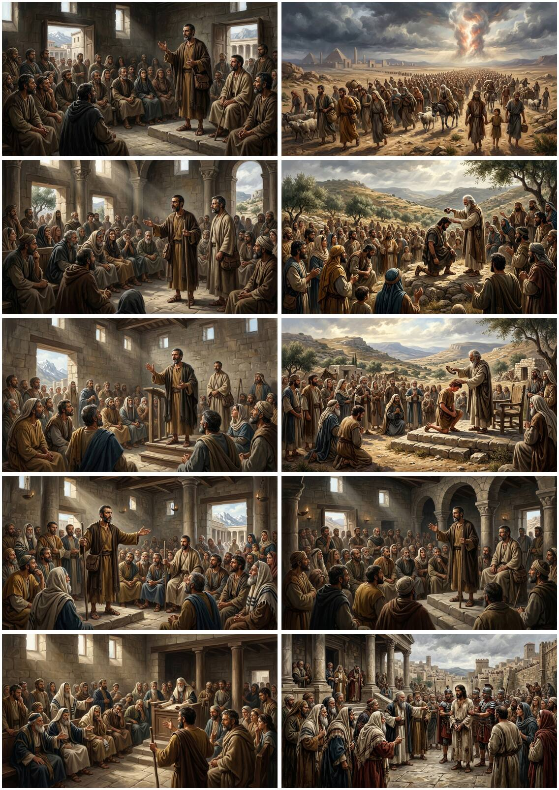

# Told events: paint what a speech tells, not the speaker again

**Prompt `2026-11-24-lean-v7` paints words that tell of another time or place as what they tell.** It keeps the speaker scene for words addressed to the people present. A text preview read 40 verses:
- Told events rose from 7 and 6 of 26 to 23 and 22 (raw). With the same reading of descriptions applied to every round, that is 8 and 8 to 24 and 24.
- Speeches to the people present kept the speaker in every round.

Six real images came out as intended, apart from one depiction fault (below). The rule was tuned on these same 40 verses. A further 14 untouched verses were previewed afterwards. The work spent $0.4979 of the owner's $0.50 OpenRouter budget on the dev key, with no production write. **Not released:** see [Before release](#before-release).

*Left: production's lean-v6 images. Right: v7, with the prompts otherwise the same. Rows: Acts 13:17 (the exodus), 13:21 (Saul made king), 13:22 (David), 13:26 ("Brothers… to you is sent", which keeps Paul), 13:27 (the rulers condemn Jesus).*

## The problem

The owner, reading Acts 13 in production, found eleven of twelve images of Paul's synagogue speech (13:16-27) to be the same scene: Paul talking to the synagogue. Meanwhile the words told of Egypt, the wilderness, Canaan, the judges, Saul, David and John.

The lean prompt caused it: "When someone speaks, show the speaker and listeners where they are; never paint the content of the speech as a separate scene or as figures beside them." Acts 13:22 does not even name Paul, so the neighbouring verse alone made it a speech. That sentence entered with the lean prototype (`662e39a5`) and reversed [ADR 0006](../../../docs/adr/0006-unseen-presence-speakers-and-launch-bar.md)'s speaker rule without a decision.

## The rule

In HOW TO READ IT ([lean.ts](../../../src/lib/engine/lean.ts)):

> When the moment is someone's words, including a speech, prayer or story that began before it, judge what these words do, not their neighbours. If they tell of events, people or places away from where they are said (history, a memory, a story or parable, a dream, vision or prophecy), paint what they tell, in its own time and place and its own era's dress, even when the words also address the listeners; anyone quoted inside the telling belongs to the told scene. Leave the teller and listeners out unless the text puts them inside it. Paint the speaker and listeners where they are only when the words are about those people there (a greeting, question, reply, command, warning or appeal) or the moment only says that someone spoke. Never both in one picture: no inset, bubble or second scene beside the speaker.

Rule 3 now reads "Nothing from outside the era of what is painted" (was "the moment's era"), so the rules no longer require a told event to take the section's era. That is intent: the preview cannot see dress, and rule 3 was changed in every round, never alone.

A full picture was chosen over a bubble or inset. Rule 2 already forbids collage, a bubble reads as a comic in the painterly styles, and the reader sees the verse beside the picture, so the speech frame is not lost. The "never both" clause guards a fault seen in no preview or image. It stays because the owner raised bubbles.

## Method

The climb had a fixed evidence set and metric. The harness was scratch code outside the repository; a release folder keeps data, not code ([image eval workflow](../../workflow/IMAGE_EVAL_AND_RELEASE.md)).

- **Cases** ([cases.json](cases.json)): 40 Bible verses.
  - 26 told events, four of them `told-self`, where the teller is inside their own story.
  - 10 `present`, where the words concern the people present.
  - 4 controls.
- **Prompts:** built by the checkout's own `assembleLean` from production's Bible analysis, through public reads, in Classical at 16:9. On the 14 verses with a lean-v6 image in production, they match the stored prompt byte for byte. The v7 code builds exactly the measured v3 variant for all 40. Each candidate replaced only the HOW TO READ IT line and rule 3 ([variants.json](variants.json), with the production `v6` text for comparison).
- **Metric:** `google/gemini-3.1-flash-lite`, reasoning off, temperature 0.2. A system message asked it not to paint but to reply in JSON: a description, who says the moment's words, whether that speaker and their listeners are visible, whether the picture shows told events, and whether it has an inset or bubble.
  - A `told` case passes when neither speaker nor listeners are visible; a `told-self` case when no listeners are.
  - A `present` case passes when the speaker is visible.
  - Any inset fails. Controls were read by hand.

  One call costs about $0.0006. On the baseline it reproduced production's choices on Acts 13. Nano Banana 2.1 in text mode cost $0.0115 a call, because it reasons first, which was too much for the budget.
- **Real images:** v7 prompts on `google/gemini-nano-banana-2.1` at 16:9, 1K, with production's reference sheets attached as production attaches them. They sit beside production's existing lean-v6 images, which cost nothing.

## Rounds

| Round | Change | Told, raw (of 26) | Told, adjudicated | Present (of 10) |
| --- | --- | --- | --- | --- |
| 0, lean-v6 | | 7, 6 (two runs) | 8, 8 | 10, 10 |
| 1 | The rule as first proposed | 19 | 21 | 10 |
| 2 | + a speech begun earlier; "even when the words also address the listeners" | 21 | 21 | 10 |
| **3, kept** | + "judge what these words do, not their neighbours"; quoted people belong to the told scene | **23, 22** | **24, 24** | 10, 10 |
| 4 | + a moment that says someone spoke and gives what they told shows what they told | 22 | 22 | 10 |
| 5 | Round 3 shortened by 85 characters | 21 | 22 | 10 |

Rounds 4 and 5 were reverted. Each [proxy file](proxy/) holds every case's answer, graded by the rule above.

**Adjudication** reads each failing told case's description. It counts the case as a pass when the description shows the told scene with no teller and nobody listening to the teller. The flags failed there because the preview named a person quoted inside the telling as "the speaker":
- Matthew 13:4, the sower alone: round 0, both runs.
- Acts 13:24, John at the Jordan: round 0b and round 1.
- Genesis 41:17, Pharaoh at the Nile in his dream: round 1 and round 3b.
- Acts 13:25, John at the Jordan: round 3, both runs.
- Acts 13:21, Saul before the elders: round 5.

**Controls:** all four kept their scene in every round: Genesis 1:3 (light with no figure), Moses at the sea, Saul struck on the road, and the Antioch church at prayer.

**Present cases:**
- 2 Samuel 12:7 is mixed. "You are the man!" goes on to recount David's anointing and his rescue from Saul, so the told branch could claim it. Every round kept Nathan and David, and nine cases are unambiguous.
- Only the preview measures the present cases, except 13:26, which was also drawn. The preview under-predicts told painting: on 13:27 it kept the synagogue, while the image model drew the told scene.

**Two misses remain with v3:**
- **Acts 13:27** ("…the voices of the prophets which are read every Sabbath…"): the preview kept the synagogue. The real image showed the rulers condemning Jesus.
- **Genesis 40:9** ("The chief cup bearer told his dream to Joseph, and said, 'In my dream…'"): every round kept the prison scene, including round 4, written to fix it. Genesis 37:9 and 40:16 have the same shape. The next verse carries the dream, so the owner may find this acceptable.

## Held-out preview

After the review, 14 verses no round had seen were previewed under v6 and v7 ([holdout-cases.json](holdout-cases.json), [v6](proxy/holdout-v6.json), [v7](proxy/holdout-v7.json)). Read by hand:

- **Letters, psalms, wisdom, oracle** (Romans 8:28, 1 Corinthians 13:12, Proverbs 25:3, Psalm 23:2, Isaiah 40:29): the same pictures under both. The author still appears beside their words, as under v6. No regression, and no gain.
- **Throne visions told in a speech:**
  - Micaiah's vision (1 Kings 22:19): v6 put a radiance "in the shape of a throne" behind the kings. v7 paints the heavenly court around an empty seat.
  - Daniel 7:9 and Revelation 4:6: an empty throne under both.
- **Acts 7:56** ("I see the heavens opened…"): v6 showed Stephen looking up. v7 paints the opened heavens with Jesus standing and no Stephen, though the text puts him there, seeing it. That is a regression on a vision the teller sees as he speaks.
- **Short replies that recount** (Genesis 3:13, Daniel 6:22), **Job 38:4**, the **opening of Stephen's speech** (Acts 7:2) and **a prophecy about the same place** (Mark 13:2, the temple shown intact): unchanged.

## Real images

All six were drawn by v7 at $0.045-0.050 each:

| Verse | Production (lean-v6) | v7 |
| --- | --- | --- |
| Acts 13:17 | Paul speaking | Israel leaving Egypt. It adds a pillar of cloud and fire the verse does not name, so under rule 7 that is a depiction fault, though nothing in it is a figure |
| Acts 13:21 | Paul speaking | [Samuel anointing Saul on a hillside](after-acts-13-21.jpg). Saul is dark-haired and bearded like Paul; whether the "Saul/Paul" sheet shaped him cannot be told from one image |
| Acts 13:22 | Paul speaking | Samuel anointing the young David |
| Acts 13:26 | Paul speaking | Paul speaking (unchanged, as intended) |
| Acts 13:27 | the synagogue reader | Jesus bound before the rulers and Roman soldiers in Jerusalem |
| 2 Samuel 12:3 | (none in production) | [the poor man feeding his ewe lamb at his table with his children](after-2-samuel-12-3.jpg) |

That is the operator's unblinded look, not a blind score, and six images cannot show a rate.

## Known gaps

- The 40 verses were both the tuning set and the measure. The 14 held-out verses were only read, not graded, and the real images cover Acts 13 and one parable.
- Acts 7:56: a vision the teller sees as he speaks loses the teller.
- People only told of (David, Moses, Samuel) are not in the section's cast. They are drawn as unnamed figures and will not match their look in their own books.
- Name matching offers Paul's canon and sheet ("Saul/Paul") as "named here" for King Saul in Acts 13:20-22.
- The SETTING block and the work brief still describe the section's place and era unconditionally. Rule 3 outranks the brief, and no told preview or image took the section's dress or place, but the cue is still there.
- Every prompt grows by about 670 characters against a 12,000-character cap that refuses rather than trims. Reviewers built every moment of the committed suite snapshot: the Bible's longest prompt is 9,528 characters, and Alice's court scenes reach about 11,500. Production sections with larger casts were not checked.

## Before release

[The image eval workflow](../../workflow/IMAGE_EVAL_AND_RELEASE.md) requires an image run of the regression suite (about $9) and the consistency pairing for a prompt change. Neither was run: the budget for this work was $0.50. Releasing v7 waits for that run or for the owner to waive it. Suite cases whose prompts this changes include:
- Luke 15:20 and 15:22, Deuteronomy 1:7, Matthew 5:40
- Daniel 7:9 (a golden case), Isaiah 6:2, Isaiah 40:29
- Revelation 4:6 and 21:6, Job 15:24, Romans 8:28, 1 Corinthians 13:12, Hebrews 12:1, Proverbs 8:21, Daniel 11:14

## Cost

$0.4979 by the [ledger](ledger.ndjson), on the dev key:
- $0.2116: 351 Flash Lite previews (3 pilot calls, 320 scored over eight runs, 28 held out)
- $0.0115: one Nano Banana 2.1 text probe
- $0.2749: six images
