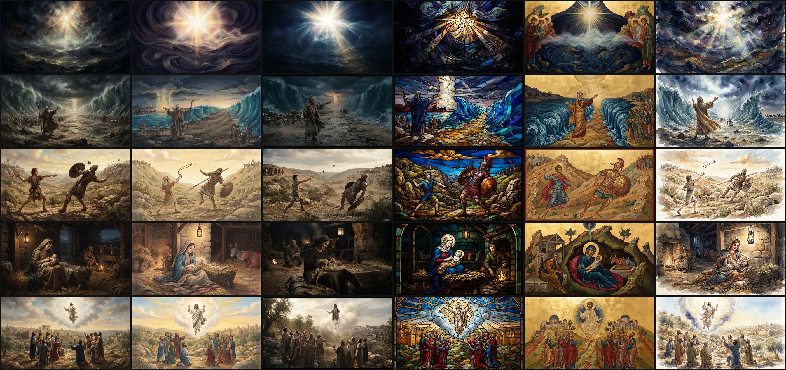
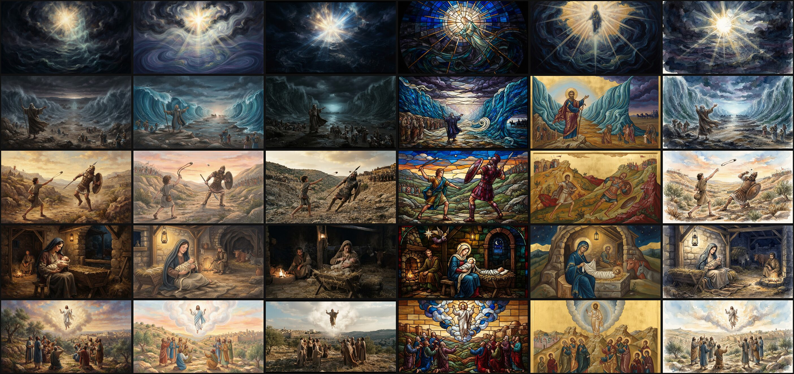

# PROTOTYPE: Which two art styles join Classical?

Throwaway branch for the wayfinder ticket [Which two art styles join Classical?](https://github.com/AustinKelsay/visibible/issues/138). Never merge it. The verdict is recorded on the ticket.

Run on 2026-10-17 with `google/gemini-3.1-flash-lite-image`, 16:9, WEB translation. The script is [`src/lib/art-styles.prototype.ts`](../art-styles.prototype.ts) and the style briefs are in it.

- Each verse got one scene plan from the free planner, written with the Classical profile. Every style reused it, so the style is the only variable.
- **Production budget** (this folder): today's 2,800-character limit.
  - All 30 prompts lost their palette, lighting, texture and composition lines.
  - 24 of 30 lost the neighbouring-verse continuity hints.
  - 2 were hard-truncated, losing the global negatives and the aspect-ratio line: Exodus 14:21 in Classical and in Storybook.
- **Full brief** ([`full-brief/`](full-brief/)): the budget was raised to 4,000 with the same scene plans. Nothing was trimmed, and the largest prompt was 3,591 characters.
- Spend: $1.0125 + $1.0136 = **$2.03** for 60 images, at about 4 s each.

Columns are Classical, Storybook, Cinematic, Stained glass, Byzantine icon and Ink & watercolour. Rows are Genesis 1:3, Exodus 14:21, 1 Samuel 17:49, Luke 2:7 and Acts 1:9.

**Full brief**

**Production budget**

## Observations

- **Distinct from Classical:** Byzantine icon and Stained glass are clearly distinct, and so is Ink & watercolour. Cinematic changes the texture to photographic, but the staging and palette stay close to Classical. Storybook reads as a brighter Classical, even with its full brief.
- **The scene plan fixes the composition.** Within a verse, the staging is nearly identical across styles. The style changes only the rendering.
- **Full-bleed failures:**
  - Stained glass draws an oval or arched window edge (Genesis 1:3 at production budget; arched tops on Luke 2:7 and Acts 1:9).
  - Watercolour leaves white paper edges (Genesis 1:3 at production budget, and 1 Samuel 17:49).
- **Divine figures:** In Genesis 1:3, Stained glass and Icon drew a human figure in the light at production budget. With the full brief, Icon added standing saints instead. The other styles drew light only.
