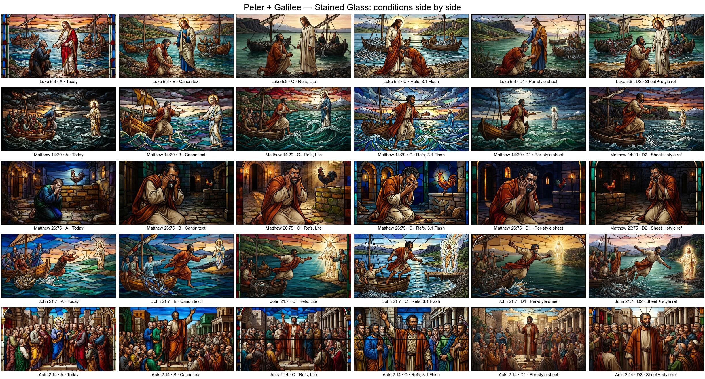

# PROTOTYPE: Does the chosen engine hold characters and locations steady across verses and art styles?

Throwaway branch for the wayfinder ticket [#142](https://github.com/AustinKelsay/visibible/issues/142), on the map [#135](https://github.com/AustinKelsay/visibible/issues/135). Never merge it. The owner records the verdict on the ticket. Everything here is a prototype draft, including the canon, the section look and the reference art.

Run on 2026-10-17. The script is [`src/lib/consistency.prototype.ts`](../consistency.prototype.ts), run with `npm run prototype:consistency -- <phase>`. The montages and the comparison page come from [`src/lib/consistency.prototype-report.mjs`](../consistency.prototype-report.mjs).

## Method

- **Verses (WEB):**
  - Peter set: Luke 5:8, Matthew 14:29, Matthew 26:75, John 21:7 and Acts 2:14. Galilee is in the cast for Luke 5:8, Matthew 14:29 and John 21:7 only; the other two verses are set in Jerusalem.
  - Exodus set: 14:21, 14:22 and 14:27, all with Moses, the Red Sea and the section look.
- **Scene plans:** each verse got one plan from the free planner (`nvidia/nemotron-3-super-120b-a12b:free`, with the Classical profile), saved in [`plans.json`](plans.json). Every condition and style reuses it.
- **Independence:** every image is its own request. References are fixed canon assets, never another verse's output.
- **Prompts:** the production `buildImagePrompt`, run at `PROTOTYPE_PROMPT_MAX_CHARS=5000` so nothing is trimmed. The canon, section-look and reference blocks are inserted before `SCENE PRESENTATION`. Each image's exact prompt and its length are in [`results.json`](results.json).
- **Styles:**
  - Classical is today's profile.
  - Ink & Watercolor and Stained Glass are the `watercolour` and `stained-glass` briefs from `prototype/art-styles`, with firmer negatives: no white margins, and no window shapes, arched tops or dark corners.
- **Canon:**
  - [`canon.json`](canon.json) holds Peter (distinctive face: crooked once-broken nose, scar through the left eyebrow, white-grey streak at the chin, rust-orange mantle), Moses at his elder life stage, the Sea of Galilee and the Red Sea crossing site.
  - Its rules: people are ancient Near Eastern, and God is never a human figure.
- **Section look:** [`section-look.json`](section-look.json) covers Exodus 14:15–31. It started as a draft from the free model ([`section-look.draft.json`](section-look.draft.json)) and was expanded by hand, because the draft had no light colours and no Egyptian clothing.
- **Reference art:** made with 3.1 Flash at 16:9 1K and stored as JPEG in [`refs/`](refs/):
  - Three-view Classical sheets for Peter and Moses, with a close-up portrait in each.
  - A two-view Galilee sheet: a high establishing view and a ground-level shore.
  - A one-view Red Sea image.
  - Watercolor and Stained Glass Peter sheets, repainted from the Classical sheet.
  - Two people-free style references.

  None had text or labels. The first Watercolor style reference left white paper margins, so it was regenerated; the rejected one is kept as `refs/style--watercolour.rejected-1.jpg`.

| Condition | Model | Adds | References per image |
| --- | --- | --- | --- |
| A, today | Lite | production text prompt only | 0 |
| B, canon text | Lite | canon text, plus the section look for Exodus | 0 |
| C, references | Lite and 3.1 Flash | B plus Classical reference images | 1–2 |
| D1, per-style sheet | Lite | C, with Peter's sheet painted in the target style (Watercolor and Stained Glass, Peter set only) | 1–2 |
| D2, sheet + style reference | Lite | C plus a style reference image (Watercolor and Stained Glass, Peter set only) | 2–3 |

Lite is `google/gemini-3.1-flash-lite-image` and 3.1 Flash is `google/gemini-3.1-flash-image` (sent with `image_size: "1K"`). References are base64 JPEG `image_url` parts on the production chat-completions request. All 116 images were served by Google.

## Spend

**$5.400406**, from `usage.cost` on 125 billed calls; [`ledger.json`](ledger.json) lists every call.

- Reference art: $0.607311 for 9 images, including the rejected style reference ($0.0673).
- Verse images: $4.793095 for 116.
- The planner and the section-look draft were free.
- The first session stopped at $2.096152, when OpenRouter returned HTTP 402 `in_flight_budget_exhausted` on an account that was nearly empty. The 29 failed calls were not billed. After a top-up, the run resumed and finished at $3.304254 more.
- Map total: $2.93 before this ticket, plus $5.40, is about **$8.33 of $10**.

## Results

Contact sheets are in [`montages/`](montages/). The conditions-side-by-side sheets are the quickest read:

- [Peter · Classical](montages/peter--classical--by-condition.jpg) · [Peter · Watercolor](montages/peter--watercolour--by-condition.jpg) · [Peter · Stained Glass](montages/peter--stained-glass--by-condition.jpg)
- [Exodus · Classical](montages/exodus--classical--by-condition.jpg) · [Exodus · Watercolor](montages/exodus--watercolour--by-condition.jpg) · [Exodus · Stained Glass](montages/exodus--stained-glass--by-condition.jpg)
- One sheet per set and condition (verses × styles): `montages/<set>--<condition>.jpg`. Reference art: [`montages/references.jpg`](montages/references.jpg).

### Costume

- **A:** Peter's clothes change every verse (grey, green, brown, blue), and Moses's robe and staff vary.
- **B:** canon text alone fixes them in every style. Peter wears the oatmeal tunic and rust-orange mantle in 15 of 15 images, and Moses has the red mantle with an ochre border, white beard and crooked staff in 9 of 9.
- **C and D** keep the same costume. On the Stained Glass Peter sheet the mantle drifted to crimson, and D1 Stained Glass images inherited that.

### Face marks

- Curly black hair and the white-grey chin streak appear in close shots from **B** on.
- With references (**C**), Peter's face is closer to the sheet: a receding hairline and a broad, heavy face.
- The scar and the crooked nose are too small to read at 1K in these medium and wide shots, and they also faded on the Stained Glass sheet. No image put Peter's face on a second person.

### Location

- **B:** text brings cliffs and a snowy peak to Galilee, but not one geography.
- **C, both models:** Galilee is one recognisable lake in all 18 images: the same flat-topped cliff, snowy Hermon, black basalt shore and tarred boats.
  - No image pasted a reference in as a fixed backdrop, unlike the research's 4 of 4 on Lite. The compositions follow the scene plans.
  - There is a framing bias, though: the cliff sits on the right in about 6 of 9 Lite images and 8 of 9 Flash images, as it does in both sheet views.
- **Red Sea:** the one-view reference added nothing visible over the text canon, and no image copied its calm-sea view.

### Section look

- **B and C:** Exodus 14:21, 14:22 and 14:27 share red-brown mountains, blue-green water walls, the amber pillar glow, Israelites in striped cloaks, and night-to-dawn light.
- **A:** the three verses share no landscape, light or palette.
- One miss: Flash's Watercolor 14:21 is drawn in daylight against the section look's night.

### Style fidelity

- **Classical references pull Lite back toward Classical.** In Stained Glass C-Lite, Luke 5:8 reads as a painting. 3.1 Flash keeps all three styles with the same references.
- **On Lite:**
  - D1 (per-style sheet) gives the strongest Stained Glass.
  - D2 (Classical sheet plus style reference) recovers most of the glass look and keeps Peter's true rust colour.
  - Watercolor holds in every condition.
- **Style negatives still leak in every condition, A included,** so the firmer wording isn't enough. Edge brightness was measured on 12 px strips and confirmed by eye:
  - Watercolor white margins: 2 of 8 in A, 1 of 8 in B, 4 of 8 in C-Lite, 2 of 8 in C-Flash, 1 of 5 in D1, and 0–1 of 5 in D2.
  - Stained Glass black frames: 2 of 8 in A, 1 of 8 in B, 1 of 8 in C-Flash, and 5 of 5 in D1, because the Stained Glass sheet has a lead frame. Several more images have arched tops or window side panels (C-Lite Matthew 26:75 and Acts 2:14, D2 Matthew 26:75, and window mullions in A and B Exodus).

### Duplicates, bleed and text

- With at most 3 references, no image duplicated Peter or Moses, and none contained text.
- In Acts 2:14, other apostles pick up Peter's rust colour (B, C-Lite and D).
- Jesus has no canon entry, and in several A images he is drawn the conventional European way.

### Cost, latency and prompt length

| Condition | Images | Credits | USD per image | Latency p50 / p90 / max | Prompt chars | Prompt tokens |
| --- | --- | --- | --- | --- | --- | --- |
| A, Lite | 24 | 5 | 0.0338 | 3.9 / 4.9 / 6.0 s | 3,037–3,799 | 693–856 |
| B, Lite | 24 | 5 | 0.0338–0.0340 | 4.0 / 4.8 / 7.7 s | 4,061–6,336 | 929–1,447 |
| C, Lite | 24 | 5 | 0.0341–0.0346 | 5.0 / 6.6 / 6.9 s | 4,557–6,997 | 2,160–3,836 |
| C, 3.1 Flash | 24 | 9 | 0.0683–0.0691 | 9.6 / 10.6 / 10.9 s | 4,557–6,997 | 2,160–3,836 |
| D1, Lite | 10 | 5 | 0.0341–0.0345 | 4.6 / 5.8 / 6.1 s | 4,575–5,998 | 2,164–3,613 |
| D2, Lite | 10 | 5 | 0.0344–0.0348 | 5.1 / 5.9 / 6.1 s | 4,687–6,110 | 3,309–4,758 |

- **References:** each bills as about 1,100 prompt tokens, confirming the research.
- **Lite:** stays at 5 credits and under 8 s with up to 3 references.
- **3.1 Flash:** 9 credits, with 8 of 24 images over 10 s (median 9.0 s with one reference, 9.9 s with two). The research found its Quote reaches 10 credits from the third reference.
- **Canon block size:** +1,024 characters for Peter, +1,582 for Peter with Galilee, and +2,537 for Moses with the Red Sea and the section look. The reference instructions add another 496–684. Prompts reach 7,000 characters, against today's 2,800 budget.

## Open problems

1. **Canon characters appear when the plan leaves them out.** The 14:22 plan shows only the people crossing, yet Moses was drawn in 9 of 9 B and C images. The section cast puts him in every canon block. The verse's cast should probably come from the scene plan (who is in this moment), not the whole section.
2. **Stained Glass still draws window frames, arched tops and black borders,** and Watercolor still leaves white margins, in every condition. The per-style Stained Glass sheet makes frames worse, so sheets need their own full-bleed check.
3. **Canon text is long.** Its block runs 1,000–2,500 characters (Peter with Galilee is about 1,600), against the research's estimate of 300–840. It needs compact rendering or a larger budget ([#143](https://github.com/AustinKelsay/visibible/issues/143) and [#144](https://github.com/AustinKelsay/visibible/issues/144)).
4. **Location references bias framing.** The cliff side repeats. A multi-view sheet with views facing different directions, or a rotated set of views, may help.
5. **Faces at 1K:** the small marks don't survive. The grey streak, hair and build carry identity; a scar does not.
6. **Uncanonised people:** apostles pick up Peter's colour, and Jesus drifts toward a European look. Both point to giving every section-cast member canon, and to a colour-exclusivity line.

## Suggested verdict options (for the owner; not decided here)

- **Model:**
  - (a) Lite with canon text and 1–2 references in every style, plus a style reference for Stained Glass: 5 credits, about 5 s.
  - (b) 3.1 Flash everywhere: best style fidelity with references, but 9–10 credits and right at the 10 s ceiling.
  - (c) Lite for Classical and Watercolor, and 3.1 Flash for Stained Glass.
- **Reference cap:** at most 3 per image (1 character, 1 location, plus an optional style reference) showed no duplicates here. More than 3 was not tested.
- **Sheets:**
  - One Classical sheet per entity, plus one style reference per style (D2), kept colours true and needs one sheet per entity.
  - Per-style sheets (D1) give stronger style but need colour and frame review for every sheet.
- **Text canon is the cheap base:** it delivers costume and section consistency at today's cost. References add place identity and some facial resemblance.

## Files

- `canon.json`, `section-look.json`, `section-look.draft.json` and `plans.json`: the inputs.
- `refs/`: the reference art. `images/`: 116 verse images named `<verse>--<style>--<condition>-<model>.jpg`.
- `results.json`: per-image metadata, including prompt, references, cost, credits, latency and prompt tokens. `ledger.json`: every OpenRouter call, including unbilled 402s and the rejected reference.
- `observations.json`: review notes used by the montages and the comparison page. `montages/`: the contact sheets.
